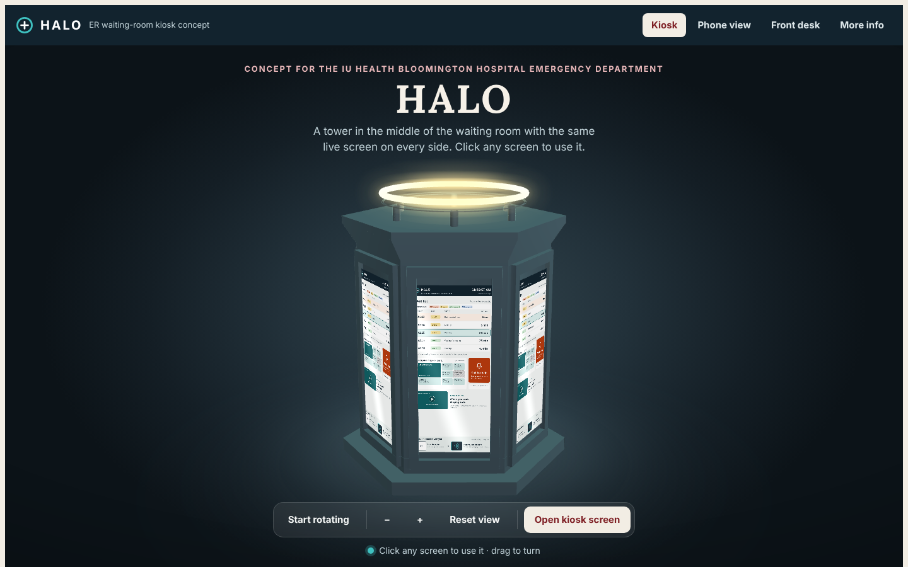
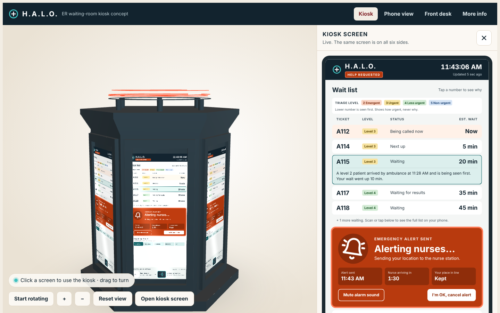

# HALO Kiosk

An interactive prototype of **HALO**, a live wait screen for the emergency room waiting room, designed as a concept for the **IU Health Bloomington Hospital** emergency department. A six-sided kiosk tower stands in the middle of the room with the same live screen on every side, and patients can scan a QR code or tap their phone to see the same information on their phone. Both share one live wait list.

> Student project. Not affiliated with or endorsed by IU Health.

**Live demo:** https://wasiangrime.github.io/HALO-Kiosk/

## How the site works

- **Kiosk:** the home page is a 3D model of the tower, rebuilt from our PrusaSlicer print file. All six sides show the live kiosk screen. Click a screen and the full kiosk opens in a panel on the right. Whatever you clicked on the 3D screen also happens: Call for help sets off the alarm (the tower's glowing halo flashes red), a map place opens directions, a ticket shows its reason, the video plays, and the tap pad sends the page to the phone. Drag to turn the tower, zoom, or press **Start rotating**.
- **Phone view:** opens the phone page in the right-side panel, synced to the kiosk. Tabs at the top of the panel switch between the kiosk screen and the phone.
- **Front desk:** the staff check-in panel with triage levels and the current line.
- **More info:** why HALO exists, the features, how we got here, the concept PDFs and the print file.

The 3D viewer is built into the page (plain WebGL), so the whole site is one file that works offline.

## What it does

| Feature | What happens |
|---|---|
| Live wait list | The clock runs in real time and the list updates every 10–18 seconds. A note says what changed, and tapping a ticket shows why its wait moved. |
| Triage levels | Each ticket shows its triage level (2 Emergent to 5 Non-urgent). Patients are seen by level first, then by arrival time. The screen shows only the ticket number and level, never a name or the reason for the visit. Level 1 patients go straight back and never appear. |
| Front desk check-in | A staff panel on the page: after the triage nurse assigns a level, one tap prints the ticket, texts the link and places the patient in the right spot in line. Everyone behind them sees why their wait changed. |
| Tap your phone | Next to the QR code is a glowing pad. Hold your phone near it, like tap to pay, and the HALO page opens on your phone. No app needed. (In a real kiosk this is an NFC tag; in the demo, click the pad.) |
| Call for help | The button grows into a flashing alarm that covers the map, the tower's light ring turns red, and a countdown shows when the nurse arrives. Patients keep their place in line. Works from the phone too. |
| Detailed map | Tapping a place opens a floor plan with a moving route from "You are here," hours, walking time and a full map key. |
| Patient education video | A 30-second captioned stick-figure spot with three safety tips: clean hands, ask before you eat or drink, and tell staff if you feel worse. |
| Phone page | A simple ticket card (number, triage level, wait, people ahead) stays pinned to the top as you scroll. The wait list is a dropdown, so the map and video are a short scroll away. Everything stays synced to the kiosk. |
| 3D tower | The home page: the printable tower model with live, clickable screens on all six sides. The original print file is in [`model/`](model/). |

  
  
  

  
  
  

## Concept write-up

- [2-page summary (PDF)](docs/HALO-concept-system-2-pages.pdf)
- [4-page concept system with diagrams and evaluation (PDF)](docs/HALO-concept-system-4-pages.pdf)

## Running it

Everything is in one file, `index.html`, with no build step and no server needed. Open it in any browser, or use the live demo link above.

All tickets, times and places are examples. This prototype is not connected to a real hospital system and is not affiliated with or endorsed by IU Health.

*[TEAM NAMES] · ER Wait-Time Concept*
